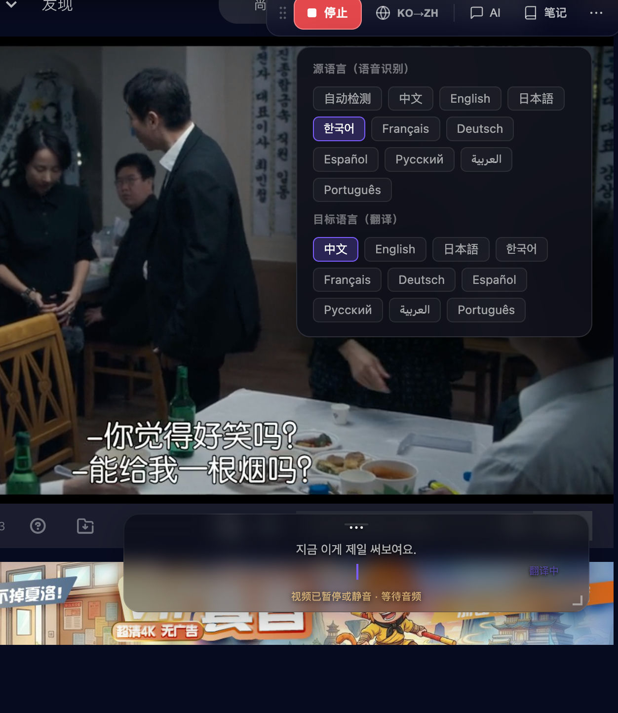
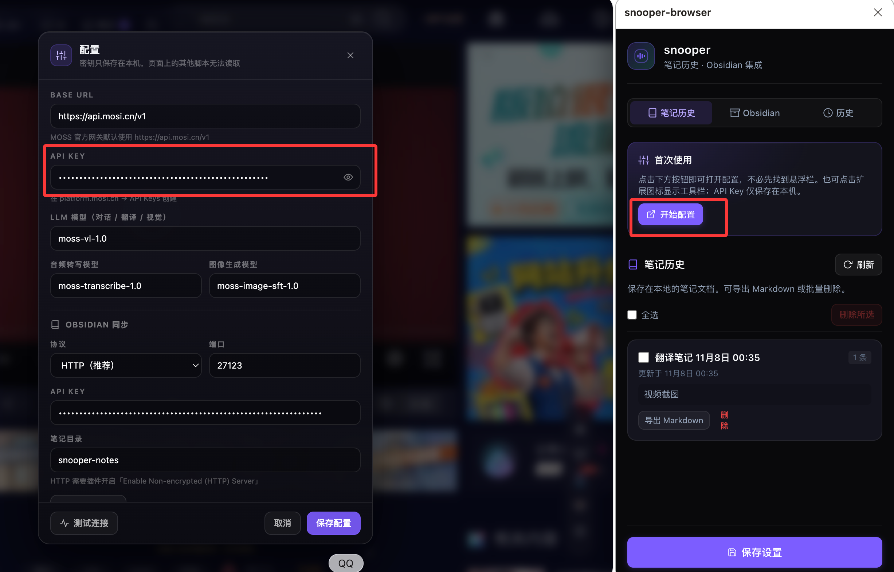
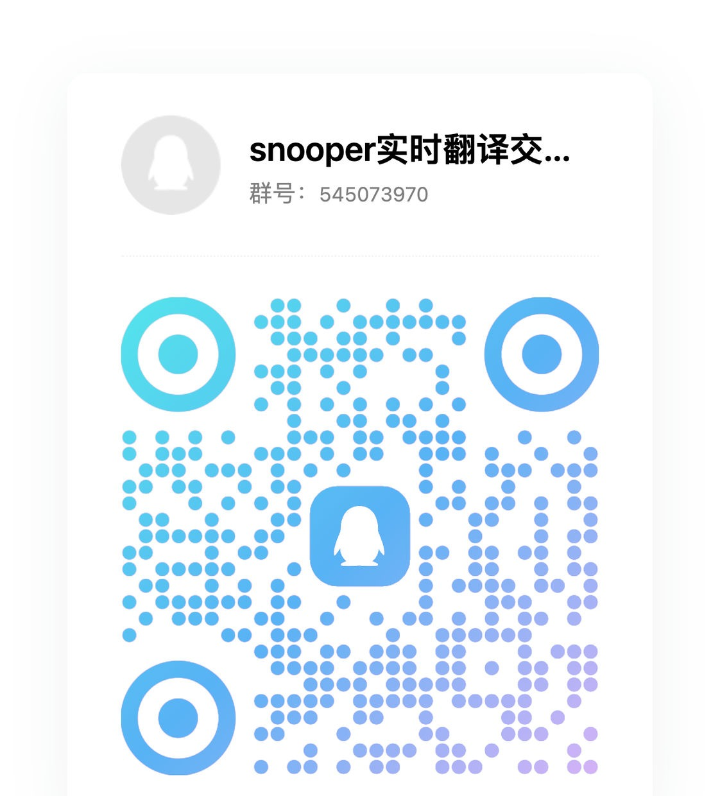

# snooper

**See it. Translate it. Understand it.**

[](./LICENSE)
[](https://vuejs.org)
[](https://vite.dev)
[](https://tailwindcss.com)

English · [简体中文](./README.zh-CN.md)

snooper is an open-source multimodal workspace that runs entirely in the browser. Capture tab or microphone audio for real-time bilingual subtitles, question a vision model about what is on screen, and route every capability to whichever provider you trust. No backend, no bundled keys, no telemetry.

## Features

### Real-time subtitles



The screenshot shows the in-page toolbar (stop, language pair, AI, notes), the
language picker with separate source and target rows, burned-in video subtitles
plus snooper's own overlay, and the "waiting for audio" state shown when the
video is paused or silent.

- Two audio sources: microphone, or tab audio through `getDisplayMedia({ audio: true })`.
- The original playback is **never muted** — subtitles and video coexist.
- Speech detection is local: silent segments are dropped before any request,
  and known ASR hallucination patterns (stock phrases, `123456789`, `[whistle]`)
  are filtered before translation.
- Source languages (speech recognition): **automatic detection (default)**,
  Chinese, English. The matching language hint is sent to the audio model;
  `auto` omits the hint.
- Target languages (translation): zh / en / ja / ko / fr / de / es / ru / ar / pt.
  Switching applies to the next line.
- Non-streaming transcription requests (`response_format=json`,
  `temperature=0`) verified against the MOSS gateway; translation streams via SSE.
- Built-in demo stream, so the subtitle animation can be reviewed without any key.

### Chat

- Multimodal input: text, images and code in the same thread.
- Markdown rendering with Shiki highlighting; streaming output can be stopped at any time.
- History is flattened into a single user message, which is what single-turn models require.
- Attach images by drag-and-drop, paste, or file picker.
- In the extension, the companion drawer can cite screenshots saved in notes,
  and both the companion and note editors offer a comfortable multi-line input
  that grows while typing and scrolls past a bounded maximum.
- Generate images in the page and send them straight to notes or the companion
  chat; three playful prompts cover roasting the image, continuing the plot,
  and writing a line of dialogue. The generation panel is a mask-free corner
  overlay, so the video keeps playing visibly while you type.
- The companion chat remembers the conversation: recent turns are replayed as
  context, a **New topic** button starts a fresh thread, and memory survives
  service-worker restarts for the life of the browsing session.
- Generated images are materialised into data URLs in the background, so a
  third-party CDN, CSP rule, or expired signature cannot leave a blank frame
  after a "successful" request.

### Image understanding

- Up to 10 images per run, 20 MB each, compressed in-browser before upload.
- Six presets: full description, text extraction, chart reading, code reading, image translation, product analysis.
- Markdown results, run history, and a lightbox for the source images.

### Provider management

- **Multiple providers side by side**: official gateway, third-party relay, or a self-hosted endpoint, each with its own base URL and key.
- **Three independent capability routes**: `LLM` (chat / vision / translation), `Audio` (ASR) and `Video` (low-latency frame understanding) may point at different providers and models.
- **Model discovery** via `GET /models`, cached per provider with status and the raw error message.
- Works with any OpenAI-compatible relay; the MOSS protocol is built in.
- Configuration and keys live only in `localStorage`.

### Notes and export

- Save subtitle lines and page screenshots as notes from the in-page toolbar.
- Video screenshots come from the composited tab surface; a `<video>` is only a
  crop hint, so hidden players or cross-origin iframes fall back to a full-page
  capture instead of an error.
- After 6.5 seconds without a new subtitle, the subtitle box collapses and
  fades; a new line or a nearby pointer restores it.
- Review, edit, and delete notes in the extension side panel; export the full
  transcript with notes as Markdown for Obsidian or any plain-text workflow.
- Optional Obsidian sync through the Local REST API plugin, verified with a
  connection test before saving.

## Quick start

```bash
cd app
pnpm install
cp .env.example .env.local   # optional — the app can be configured in the UI
pnpm dev                     # http://localhost:5173
```

Production build:

```bash
pnpm build
pnpm preview
```

### Environment variables

| Variable | Required | Purpose |
| --- | --- | --- |
| `VITE_MOSS_API_KEY` | No | Pre-fills the key of the default provider on first launch |
| `VITE_MOSS_BASE_URL` | No | Base URL of the default provider (defaults to `https://api.mosi.cn/v1`) |

Both are **development conveniences only**. Regular users add providers in the app; changing them does not require a rebuild. `.env.local` is git-ignored — never commit a real key.

## Configuration

1. Open **Settings → Providers**, fill in a name, base URL and API key, then pick a protocol (`MOSS native` or `OpenAI compatible`).
2. Click **Fetch models** to call `GET {baseUrl}/models`. Results are cached; failures are shown verbatim on the provider card.
3. In **Capability routes**, choose a provider and model for **LLM / Audio / Video**. The model field autocompletes from the fetched list but accepts free text, because many relays do not implement `/models`.
4. Chat, image understanding and subtitle translation share the `LLM` route; the listening half of the subtitle pipeline uses the `Audio` route.

> Keys are written to `localStorage` and requests go straight from your browser to the provider you configured. If you deploy this publicly and need to hide the key, put a proxy in front of it.

### Get a free MOSS API key

The built-in MOSS protocol works with a key from the official platform:

1. Open <https://platform.moss.cn/> and register or sign in.
2. Create an API key in the console and copy it.
3. Keep the key private. snooper stores it only in the current browser profile.

### Initial setup



1. Open snooper: click the extension icon on a normal web page, or run the app.
2. Click **开始配置** in the side panel, or the gear button in the page toolbar.
3. Add a provider:
   - **Name**: `MOSS`
   - **Base URL**: `https://api.mosi.cn/v1`
   - **Protocol**: `MOSS native`
   - **API key**: paste the key from <https://platform.moss.cn/>
4. Click **拉取模型** to call `GET /models`. If the endpoint does not expose it,
   type the model ids manually.
5. Assign capability routes:
   - **LLM**: chat, vision, and subtitle translation.
   - **Audio**: speech recognition (the listening half of the subtitle pipeline).
   - **Video / Image**: optional low-latency frame understanding and image
     generation.
6. Click **保存**. Then start transcription on a page that is playing audio.
7. If no key is configured, snooper refuses to start and shows
   `尚未配置 API Key`; open the settings and fill the key first.

## Browser extension

The Manifest V3 extension adds an in-page toolbar and a side panel to Chrome and Edge 116+.

### Install from a release ZIP

1. Download `snooper-browser-v<version>.zip` from a release.
2. In Chrome or Edge, open the extension management page and enable **Developer mode**.
3. Use **Load unpacked** only with an extracted development directory. Store submissions use the ZIP directly in the relevant developer dashboard.
4. Pin snooper-browser, open a normal web page, and click the extension icon.
5. Open **开始配置** in the side panel or page toolbar and add a provider. No key is included in the extension package.

### Build and package locally

Run these commands from the repository root:

```bash
pnpm install
pnpm build:ext
pnpm package:ext
```

The package command rebuilds the extension, copies the 16/32/48/128 px icons, and writes:

- `dist-extension/snooper-browser-v<version>.zip`
- `dist-extension/snooper-browser-v<version>.zip.sha256`

The ZIP is intentionally readable and contains no encrypted or remotely loaded code. Chrome Web Store and Edge Add-ons require submitted code to be reviewable; minification or encryption must not be used to hide functionality. The archive root also contains `LICENSE` and `NOTICE`, so the Apache-2.0 terms and attribution travel with the package.

### First-use workflow

1. Click the extension icon on the page you want to use.
2. In **Settings / 配置**, add a provider URL, API key, protocol, and model routes.
3. Choose separate **LLM**, **Audio**, **Video**, and **Image** routes when your provider setup needs it.
4. Start microphone or tab-audio transcription. Grant the browser capture permission when prompted.
5. Use the in-page toolbar to pause, stop, save notes, export subtitles, or ask the configured model about the current page.
6. Open the side panel to review notes and transcription history, export Markdown, delete records, or configure optional Obsidian sync.

### Screenshots, notes, and citations

The page toolbar keeps screenshot and note actions in its **…** menu:

1. **Take a screenshot**: click **页面截图**. The current tab frame is saved as
   a note entry, including while recording. The preview can be downloaded or
   inserted.
2. **Save a subtitle line**: click **记入笔记** to append the current subtitle to
   the active note.
3. **Review notes**: open the extension side panel and switch to **笔记历史**.
   Each card shows the title, entry count, a short preview, and the export and
   delete actions.
4. **Cite a note image in chat**: open the companion drawer, click **引用**, pick
   a screenshot from the picker (up to 4 images), then ask the question. The
   image is sent only when you press send.
5. **Export**: **导出 Markdown** in the page toolbar exports the transcript and
   notes. When the session contains images the export is a ZIP containing
   `record.md` plus an `assets/` folder with the decoded image files — Markdown
   references them by relative path, so the archive reads correctly in Obsidian
   and any editor. Without images you get a plain `.md`. Each note card in the
   side panel exports the same way.

### Transcription history

Every finished capture is stored locally with its full subtitle list (original,
translation, timestamps; up to 500 lines per record, 100 records). Open the
side panel → **历史** to expand a record, read the transcript, copy it, export
it as Markdown, or delete it. Records saved by older versions only contain
counts and are marked accordingly.

### Obsidian sync (optional)

snooper writes Markdown through the **Local REST API** community plugin. The
plugin runs inside Obsidian and exposes the vault on localhost; it is not a
snooper-specific plugin.

1. Install Obsidian desktop and open the vault you want to write to.
2. Open **Settings → Community plugins**, turn off **Restricted mode**, click
   **Browse**, install **Local REST API**, then enable it.
3. Open the plugin settings and copy the **API key**.
4. In snooper, open the side panel → **Obsidian** and fill in:
   - **启用 Obsidian 同步**: checked
   - **协议**: `HTTP` (recommended; Chrome rejects the plugin's self-signed
     HTTPS certificate on port 27124)
   - **端口**: `27123`
   - **笔记目录**: `snooper-notes`, or any folder that already exists in the vault
   - **API Key**: paste the plugin token; the `Bearer ` prefix is optional
5. Click **测试连接**. A green `连接成功（HTTP 27123）` means the vault is
   reachable.
6. Click **保存设置**.
7. In the page toolbar, open **… → 发送到 Obsidian**. Screenshots in the note are
   first uploaded as real image files in the vault, then the Markdown document is
   written to the configured folder.
8. If the test fails, confirm Obsidian is running, the plugin is enabled, the
   port matches, and no firewall blocks localhost.

### Permissions and data flow

| Permission | Why it is needed |
| --- | --- |
| `activeTab`, `scripting` | Opens or injects the toolbar after the user invokes the extension. |
| `storage` | Stores provider settings, notes, history, Obsidian settings, and session recovery in extension storage. |
| `tabCapture`, `offscreen` | Captures and processes tab audio after the user starts transcription. |
| `sidePanel` | Provides the optional notes, history, and Obsidian panel. |
| `management` | Read-only: when another extension holds the capture stream, the error hint lists which extensions hold the `tabCapture` permission. |
| `<all_urls>` | Allows the user-invoked toolbar to work on arbitrary websites. |

Audio goes to the configured Audio provider only during transcription. Chat text and images go to the configured LLM or Image provider only when submitted. Notes, history, and API keys stay in the browser unless the user explicitly exports a file or enables Obsidian sync. See [SECURITY.md](./SECURITY.md) for the threat model.

### Troubleshooting

- **The toolbar does not appear:** refresh the page, click the extension icon again, and confirm that the page is not a browser-internal page such as `chrome://` or `edge://`.
- **No audio is captured:** grant microphone or tab-audio permission, check that the tab has audio, and stop any other capture extension using the same tab.
- **Requests fail:** verify the provider base URL, API key, protocol, CORS policy, and selected model. Use **Fetch models** when the provider exposes `/models`; otherwise enter the model id manually.
- **The side panel cannot open:** use a normal web page and invoke the extension from a user gesture. Browser settings pages do not allow content injection.
- **Obsidian sync fails:** install and enable Obsidian Local REST API, verify the port and token, and use **测试连接** before saving.

### Store submission

Store-specific descriptions, permission justifications, privacy disclosures, and reviewer steps are in [`docs/store/`](./docs/store/). Before submitting, replace the placeholder privacy-policy references with a public HTTPS URL and provide reviewer test credentials or a test endpoint only through the store's private review fields.

## Tech stack

| Layer | Choice | Why this and not the alternative |
| --- | --- | --- |
| Framework | Vue 3.5 (`<script setup lang="ts">`) | One reactive store per capability, no router, no SSR — a single-page tool does not need a meta-framework. |
| Build | Vite 8 | Native ESM dev server; the only build-time plugin is Vue's. |
| Language | TypeScript 6, `strict` + `noUnusedLocals` | Catches the whole class of "renamed a field and forgot a call site" bugs in the config/routing layer. |
| Styling | Tailwind CSS 4 (design tokens in `main.css`) | Tokens are the design system; no component library to fight against. |
| Icons | `@lucide/vue` | Tree-shaken imports, consistent stroke weight. |
| Markdown | `markdown-it` + Shiki | Shiki ships the TextMate grammar, so code rendered in chat looks like an editor, not a `<pre>`. It loads lazily on the first markdown view with five core languages. |
| Toasts | `vue-sonner` | Two lines of integration, accessible by default. |

### Version policy

- Dependencies track the latest release, **with one deliberate exception**: TypeScript is pinned to the latest 6.x. `vue-tsc` 3.3.x resolves `typescript/lib/tsc`, which TypeScript 7 no longer exports — running `vue-tsc` against TS 7 fails with `ERR_PACKAGE_PATH_NOT_EXPORTED`. Revisit when `vue-tsc` ships TS 7 support.
- `@types/node` tracks the Node major used for the build (currently 22), not the newest published types.
- `lucide-vue-next` was replaced by `@lucide/vue` after the former was deprecated upstream.
- Updates arrive weekly through Dependabot; majors are reviewed by hand. The check is always the same: `pnpm exec vue-tsc -b --force && pnpm build`.

## Project structure

```
app/
├── index.html
├── public/favicon.svg
└── src/
    ├── assets/main.css        # design tokens, glass surfaces, markdown typography
    ├── components/            # brand mark, layout shell, form primitives
    ├── composables/
    │   ├── useRealtime.ts     # capture → segment → transcribe → translate → subtitles
    │   ├── useChat.ts         # conversation and attachments
    │   ├── useVision.ts       # image analysis
    │   ├── useSettings.ts     # provider CRUD, routes, /models sync
    │   └── useNavigation.ts
    ├── lib/
    │   ├── providers.ts       # config model, defaults, migration, resolveRoute
    │   ├── moss.ts            # OpenAI-compatible client: streaming fallback, ASR, vision
    │   ├── models.ts          # message types, model catalogue, languages
    │   ├── markdown.ts        # Shiki highlighting
    │   ├── navigation.ts      # views and keyboard shortcuts
    │   └── brand.ts           # brand and storage keys
    └── views/                 # Translate / Chat / Vision / Settings
```

## Browser support

- Chrome / Edge 116+ for tab audio and screen capture.
- Microphone capture needs `getUserMedia` permission; tab audio needs an explicit share grant.
- Safari and Firefox run chat and image understanding; audio capture support is limited.

## Privacy

- No backend, no analytics, no accounts.
- Audio is sent in 6-second segments to the provider behind your `Audio` route; images are sent as base64 to the provider behind your `LLM` route.
- Provider URLs, keys and model choices stay in the browser. See [SECURITY.md](./SECURITY.md) for the threat model.

## Community

Join the QQ group for usage questions, translation tips, and feedback:

- **Group number**: `545073970`（snooper 实时翻译交流群）
- Scan the QR code below, or click the **加入交流群** button in the extension
  toolbar — hovering shows the QR code, clicking copies the group number.

<p align="center">
  
</p>

## Contributing

Read [CONTRIBUTING.md](./CONTRIBUTING.md) before opening a pull request. Security issues should follow [SECURITY.md](./SECURITY.md) instead of the public tracker.

## License

[Apache License 2.0](./LICENSE) © 2026 snooper-browser contributors

Includes a patent grant and trademark guidance; attribution notices are recorded in [NOTICE](./NOTICE). Releases published before the license change remain available under the MIT License.
