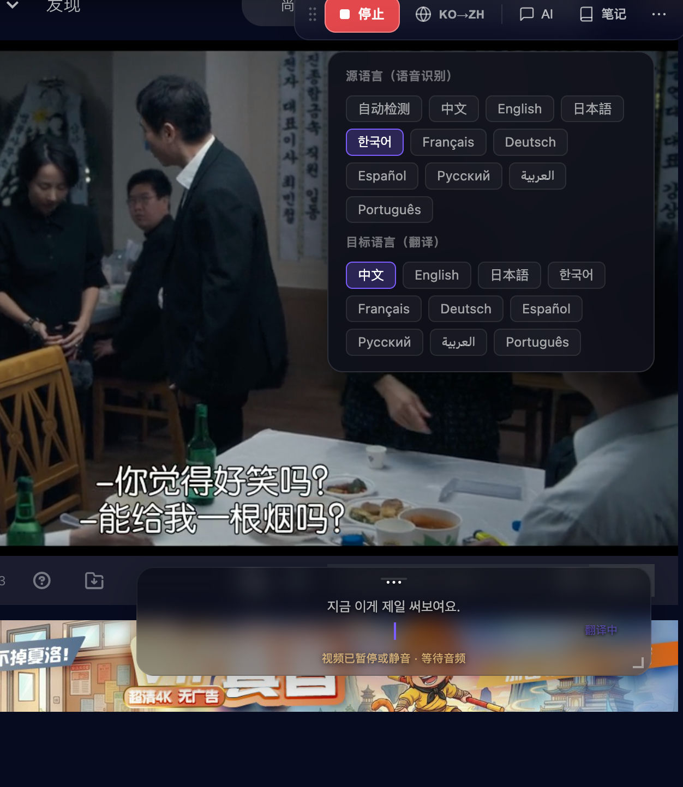
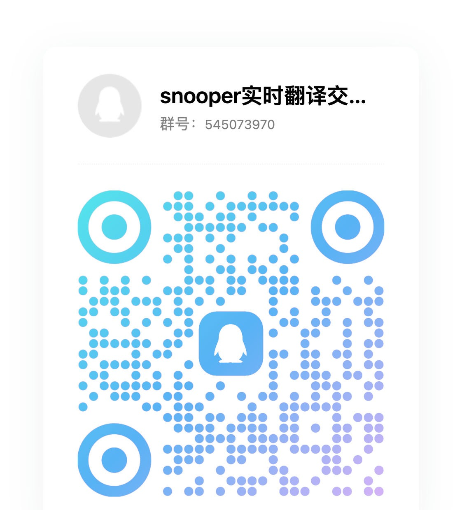

# snooper

**看得见，译得出，读得懂。**

[](./LICENSE)
[](https://vuejs.org)
[](https://vite.dev)
[](https://tailwindcss.com)

[English](./README.md) · 简体中文

snooper 是一个完全运行在浏览器里的开源多模态工作台。抓取标签页或麦克风的音频做实时双语字幕，向视觉模型提问屏幕上的内容，并把每种能力分别指向你信任的服务商。没有后端，不内置密钥，不做遥测。

## 功能特性

### 实时互译



截图中从上到下：页面内工具栏（停止、语言对、AI、笔记）、拆分后的源语言/目标语言选择、视频自带字幕与 snooper 字幕共存，以及视频暂停或静音时的「等待音频」状态。

- 两种音频来源：麦克风，或通过 `getDisplayMedia({ audio: true })` 捕获标签页声音。
- 原视频**不会被静音**，字幕与画面同时存在。
- 语音检测在本地完成：纯静音分段在请求前被丢弃，已知 ASR 幻觉话术（`Who are you?`、`123456789`、`[whistle]` 等）在翻译前被过滤。
- 源语言（语音识别）：**自动检测（默认）**、中文、English。选择了具体语言时会把语言提示传给音频模型，`auto` 则省略。
- 目标语言（翻译）：中 / 英 / 日 / 韩 / 法 / 德 / 西 / 俄 / 阿 / 葡。切换后下一条生效。
- 转写使用非流式请求（`response_format=json`、`temperature=0`），已在 MOSS 网关实测；翻译仍走 SSE 流式。
- 内置演示信号，没有任何 Key 也能完整预览字幕动效。

### 智能对话

- 多模态输入：文字、图片、代码可以放进同一个对话。
- Markdown 渲染 + Shiki 代码高亮，流式输出可随时停止。
- 历史被压缩成单条 user 消息，这正是单轮模型所要求的形态。
- 拖拽、粘贴、文件选择三种附图方式。
- 扩展中的伴学抽屉可以引用笔记里保存的截图；伴学与笔记输入框都是舒适的多行高度，随内容增长，超过上限后滚动。
- 页面内可直接生成配图，并把结果存入笔记或插入伴学对话；提供「吐槽这张图」「续写剧情」「配一句台词」三个娱乐快捷提问。
- 生图结果在后台转换为 data URL 后再显示，避免第三方 CDN、CSP 或签名过期导致“请求成功但图片空白”。

### 图像理解

- 单次最多 10 张图，单图上限 20 MB，上传前在浏览器内压缩。
- 六种预设：全面描述、文字提取、图表解读、代码识别、图文翻译、商品分析。
- 结果为 Markdown，保留运行历史，支持原图灯箱查看。

### 服务商管理

- **多家服务商并存**：官方网关、第三方中转、自建端点，各自独立保存地址与密钥。
- **三条能力独立路由**：`LLM`（对话 / 视觉 / 翻译）、`音频`（ASR）、`视频`（低延迟画面理解）可以分别指向不同服务商与模型。
- **模型发现**：调用 `GET /models`，按服务商缓存，并记录状态与原始错误信息。
- 任何 OpenAI 兼容中转都可用；MOSS 协议内置支持。
- 配置与密钥只保存在 `localStorage`。

### 笔记与导出

- 在页面工具栏把字幕行和页面截图存为笔记。
- 视频截图以标签页合成表面为准；`<video>` 只作为裁剪提示，隐藏播放器或跨域 iframe 下会退化为整页截图，而不是报错。
- 字幕连续 6.5 秒没有新内容时自动折叠并降低不透明度，新字幕或指针靠近时恢复。
- 在扩展侧边栏查看、编辑、删除笔记；把完整字幕与笔记导出为 Markdown，可用于 Obsidian 或任何纯文本工作流。
- 可选 Obsidian 同步：通过 Local REST API 插件连接，保存前先进行连接测试。

## 快速开始

```bash
cd app
pnpm install
cp .env.example .env.local   # 可选——应用内也能完成配置
pnpm dev                     # http://localhost:5173
```

生产构建：

```bash
pnpm build
pnpm preview
```

### 环境变量

| 变量 | 必填 | 用途 |
| --- | --- | --- |
| `VITE_MOSS_API_KEY` | 否 | 首次启动时预填默认服务商的密钥 |
| `VITE_MOSS_BASE_URL` | 否 | 默认服务商的地址，默认 `https://api.mosi.cn/v1` |

两者都只是**开发期便利**。日常使用在应用内添加服务商即可，切换服务商不需要重新构建。`.env.local` 已被忽略，切勿提交真实密钥。

## 配置模型

1. 打开**能力设置 → 服务商**，填写名称、Base URL、API Key，并选择协议（`MOSS 原生` 或 `OpenAI 兼容`）。
2. 点击**拉取模型**，调用 `GET {baseUrl}/models`。结果按服务商缓存；失败时原始错误会显示在该服务商卡片上。
3. 在**能力路由**中为 **LLM / 音频 / 视频** 分别选择服务商与模型。模型输入框会从已拉取列表补全，也允许手填——很多中转并不实现 `/models`。
4. 对话、图像理解、字幕翻译共用 `LLM` 路由；字幕的听写部分走 `音频` 路由。

> 密钥写入 `localStorage`，请求从浏览器直连你配置的服务商。若公开部署且需要隐藏密钥，请自行加一层代理。

## 浏览器扩展

Manifest V3 扩展为 Chrome 和 Edge 116+ 提供页面内工具栏与侧边栏。

### 使用发布 ZIP 安装

1. 从发布页下载 `snooper-browser-v<version>.zip`。
2. 在 Chrome 或 Edge 打开扩展管理页，并启用**开发者模式**。
3. 只有解压后的开发目录才使用**加载已解压的扩展程序**；商店提交时直接在对应开发者后台上传 ZIP。
4. 固定 snooper-browser，打开普通网页后点击扩展图标。
5. 在侧边栏或页面工具栏中打开**开始配置**并添加服务商。扩展包不包含任何密钥。

### 本地构建与打包

在仓库根目录执行：

```bash
pnpm install
pnpm build:ext
pnpm package:ext
```

打包命令会重新构建扩展，复制 16/32/48/128 像素图标，并生成：

- `dist-extension/snooper-browser-v<version>.zip`
- `dist-extension/snooper-browser-v<version>.zip.sha256`

ZIP 刻意保持可读，不包含加密代码，也不会加载远程代码。Chrome Web Store 与 Edge Add-ons 要求提交代码可供审核，不能用压缩或加密来隐藏功能。压缩包根目录同时包含 `LICENSE` 与 `NOTICE`，确保 Apache-2.0 的许可条款与署名信息随包分发。

### 首次使用流程

1. 在要使用的网页上点击扩展图标。
2. 在**配置**中添加服务商地址、API Key、协议和模型路由。
3. 如有需要，为 **LLM**、**音频**、**视频**、**图像**分别选择路由。
4. 开始麦克风或标签页音频转写，并在浏览器提示时授予采集权限。
5. 使用页面工具栏暂停、停止、保存笔记、导出字幕，或让配置好的模型分析当前页面。
6. 打开侧边栏查看笔记与转写历史、导出 Markdown、删除记录，或配置可选的 Obsidian 同步。

### 权限与数据流

| 权限 | 用途 |
| --- | --- |
| `activeTab`、`scripting` | 用户点击扩展后打开或注入页面工具栏。 |
| `storage` | 在扩展存储中保存服务商配置、笔记、历史、Obsidian 设置和会话恢复状态。 |
| `tabCapture`、`offscreen` | 用户开始转写后采集和处理标签页音频。 |
| `sidePanel` | 提供可选的笔记、历史和 Obsidian 侧边栏。 |
| `management` | 只读：录音流被其他扩展占用时，在错误提示中列出持有 `tabCapture` 权限的扩展名。 |
| `<all_urls>` | 让用户在任意网站使用主动打开的页面工具栏。 |

音频只会在转写期间发送给配置的音频服务商。聊天文字和图片只会在提交时发送给配置的 LLM 或图像服务商。笔记、历史和 API Key 留在浏览器内，除非用户主动导出文件或开启 Obsidian 同步。威胁模型见 [SECURITY.md](./SECURITY.md)。

### 故障排查

- **工具栏没有出现：** 刷新页面，再次点击扩展图标，并确认当前不是 `chrome://` 或 `edge://` 等浏览器内部页面。
- **没有捕获到声音：** 授予麦克风或标签页音频权限，确认标签页确实有声音，并停止同一标签页上的其他采集扩展。
- **请求失败：** 检查服务商地址、API Key、协议、CORS 策略和模型。服务商支持 `/models` 时点击**拉取模型**，否则手动填写模型 ID。
- **侧边栏无法打开：** 使用普通网页并通过用户点击触发。浏览器设置页不允许注入页面脚本。
- **Obsidian 同步失败：** 安装并启用 Obsidian Local REST API，检查端口和 Token，保存前先点击**测试连接**。

### 商店提交

商店描述、权限理由、隐私披露和审核步骤位于 [`docs/store/`](./docs/store/)。提交前请把占位的隐私政策引用替换为公开 HTTPS 地址；审核测试账号或测试端点只应填写在商店后台的私密审核字段中。

## 技术栈

| 层 | 选择 | 为什么不是另一种 |
| --- | --- | --- |
| 框架 | Vue 3.5（`<script setup lang="ts">`） | 每种能力一个响应式单例，没有路由、没有 SSR——单页工具不需要元框架。 |
| 构建 | Vite 8 | 原生 ESM 开发服务器；构建期插件只有 Vue 一个。 |
| 语言 | TypeScript 6，`strict` + `noUnusedLocals` | 配置与路由层最容易出现「改了字段名漏改调用点」，类型系统能整类拦下。 |
| 样式 | Tailwind CSS 4（设计 token 写在 `main.css`） | token 本身就是设计系统，不必和组件库的默认样式对抗。 |
| 图标 | `@lucide/vue` | 按需引入，线条粗细统一。 |
| Markdown | `markdown-it` + Shiki | Shiki 使用 TextMate 语法，对话里的代码块接近编辑器效果，而不是朴素 `<pre>`；进入 Markdown 视图时才惰性加载，仅预置五门核心语言。 |
| 提示 | `vue-sonner` | 两行接入，默认即可访问。 |

### 版本策略

- 依赖跟随最新版本，**但有一个刻意例外**：TypeScript 锁在最新 6.x。`vue-tsc` 3.3.x 会解析 `typescript/lib/tsc`，而 TypeScript 7 已不再导出该子路径——用 TS 7 运行 `vue-tsc` 会直接报 `ERR_PACKAGE_PATH_NOT_EXPORTED`。等 `vue-tsc` 支持 TS 7 后再放开。
- `@types/node` 跟随构建所用的 Node 主版本（当前 22），而不是无条件追最新。
- `lucide-vue-next` 在上游被标记弃用后，已替换为 `@lucide/vue`。
- 依赖更新由 Dependabot 每周发起，主版本升级一律人工审查。验收命令始终是同一条：`pnpm exec vue-tsc -b --force && pnpm build`。

## 项目结构

```
app/
├── index.html
├── public/favicon.svg
└── src/
    ├── assets/main.css        # 设计 token、玻璃拟态、Markdown 排版
    ├── components/            # 品牌标记、布局壳、表单基础件
    ├── composables/
    │   ├── useRealtime.ts     # 采集 → 分段 → 转写 → 翻译 → 字幕
    │   ├── useChat.ts         # 对话流与附件
    │   ├── useVision.ts       # 图像分析
    │   ├── useSettings.ts     # 服务商 CRUD、路由、/models 同步
    │   └── useNavigation.ts
    ├── lib/
    │   ├── providers.ts       # 配置模型、默认值、迁移、resolveRoute
    │   ├── moss.ts            # OpenAI 兼容客户端：流式降级、ASR、视觉
    │   ├── models.ts          # 消息类型、模型目录、语言表
    │   ├── markdown.ts        # Shiki 高亮
    │   ├── navigation.ts      # 视图与快捷键
    │   └── brand.ts           # 品牌与存储键
    └── views/                 # 实时互译 / 智能对话 / 图像理解 / 能力设置
```

## 浏览器支持

- 标签页音频与屏幕捕获需要 Chrome / Edge 116+。
- 麦克风采集需要 `getUserMedia` 授权；标签页音频需要用户显式共享。
- Safari 与 Firefox 可运行对话与图像理解，音频采集能力有限。

## 隐私

- 无后端、无统计、无账号体系。
- 音频以 6 秒片段发送给 `音频` 路由背后的服务商；图片以 base64 发送给 `LLM` 路由背后的服务商。
- 服务商地址、密钥与模型选择只留在浏览器。威胁模型见 [SECURITY.md](./SECURITY.md)。

## 社区

加入 QQ 交流群讨论使用问题、翻译技巧和产品反馈：

- **群号**：`545073970`（snooper 实时翻译交流群）
- 扫描下方二维码加入；也可以在扩展工具栏点击**加入交流群**按钮——鼠标悬浮显示二维码，点击复制群号。

<p align="center">
  
</p>

## 参与贡献

提交 PR 前请先读 [CONTRIBUTING.md](./CONTRIBUTING.md)。安全问题请按 [SECURITY.md](./SECURITY.md) 私下报告，不要开公开 issue。

## 开源协议

[Apache License 2.0](./LICENSE) © 2026 snooper-browser contributors

包含专利授权与商标使用说明；署名信息记录在 [NOTICE](./NOTICE)。协议变更前发布的版本仍按 MIT License 提供。
